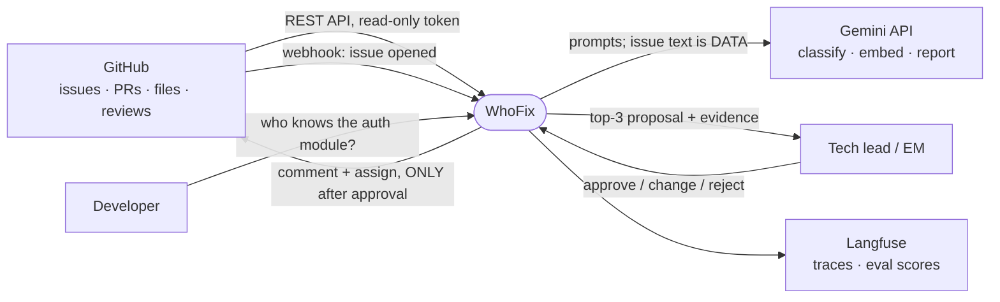
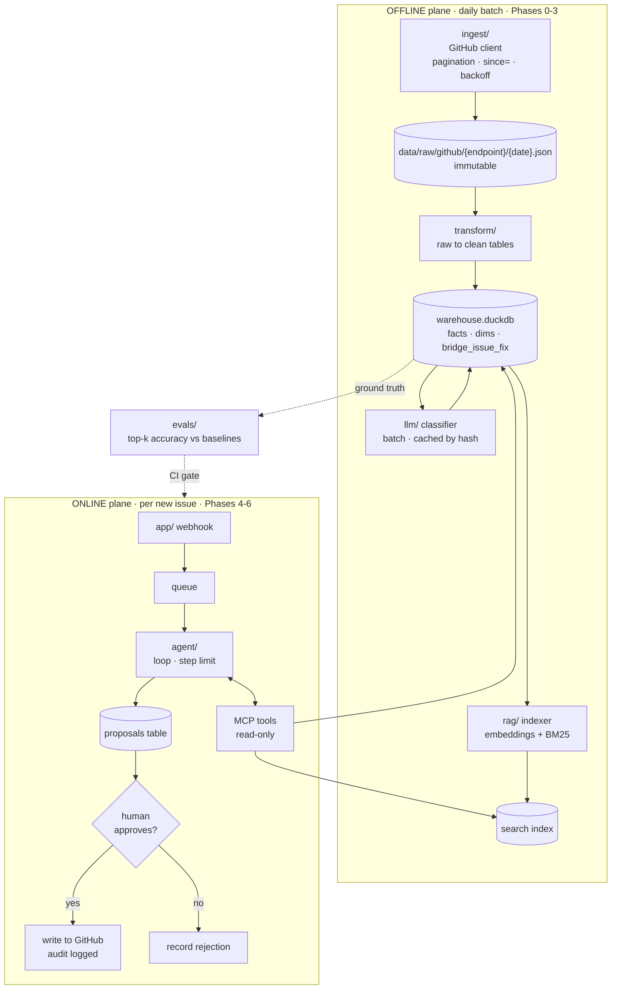
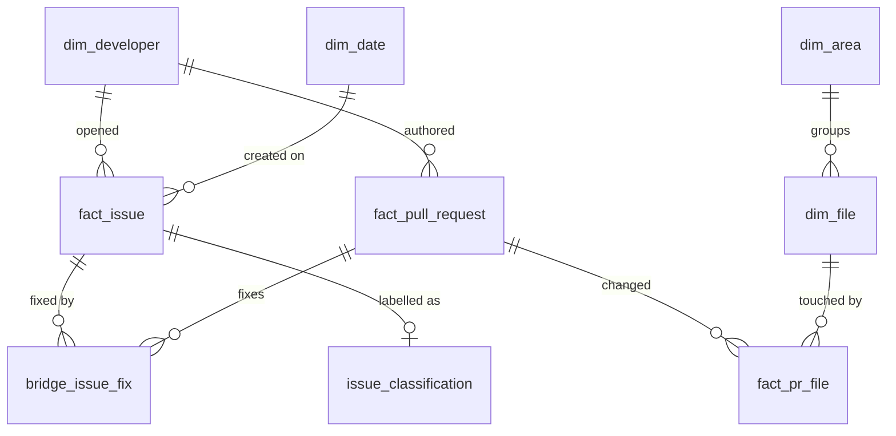
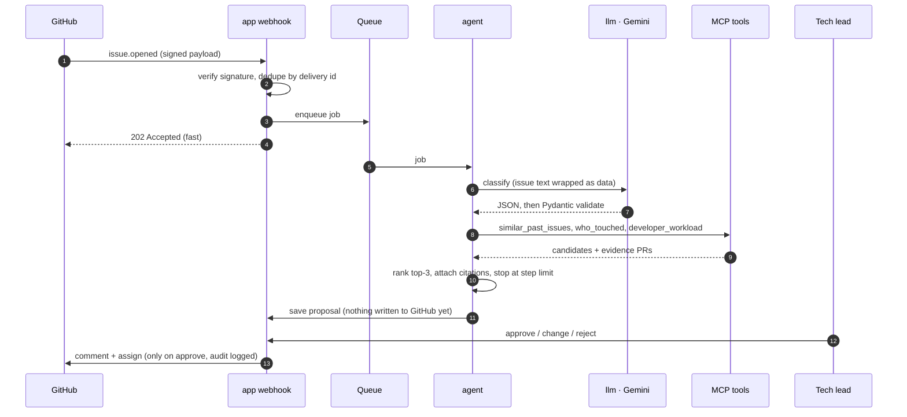
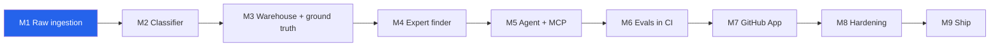
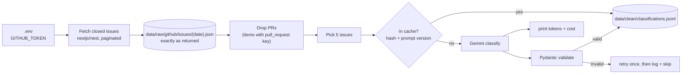

# WhoFix: Architecture

How the pieces fit, how data flows, and the order we build them in.
For *what* and *why*, see [PLAN.md](PLAN.md). For the learning schedule, see [ROADMAP.md](ROADMAP.md).

> Diagrams are Mermaid: they render on GitHub and in VS Code (Markdown Preview Mermaid Support extension).

---

## 1. System context

Who and what WhoFix talks to.

---

## 2. Two planes: offline batch vs online request

The most important split in the design. **Heavy, slow, repeatable work happens offline** (daily batch).
**The online path only reads** what the batch already prepared, so a new issue gets an answer in seconds and cheaply.

---

## 3. Components and where they live

| Folder         | Component                          | Input → Output                                   | Built in   |
| -------------- | ---------------------------------- | ------------------------------------------------- | ---------- |
| `ingest/`    | GitHub client + raw loaders        | API → `data/raw/github/{endpoint}/{date}.json` | Phase 0, 2 |
| `transform/` | Clean + model                      | raw JSON → DuckDB tables                         | Phase 2    |
| `llm/`       | Client, schemas, cost meter, cache | issue text → validated `IssueClassification`   | Phase 0, 1 |
| `rag/`       | Indexer + hybrid search            | issue → ranked developers + evidence PRs         | Phase 3    |
| `agent/`     | Agent loop + `whofix` MCP server | question / issue → proposal or answer            | Phase 4    |
| `evals/`     | Golden sets, baselines, judge      | predictions + ground truth → scores              | Phase 5    |
| `app/`       | **Django**: approval inbox (admin) + audit log; webhook later | proposals → human decision → approved write | skeleton now, webhook Phase 6 |
| `tests/`     | Unit tests                         | n/a                                               | always     |

**Dependency rule:** arrows only point *down* this list's layers: `app → agent → rag/llm → warehouse ← transform ← ingest`.
`ingest/` never imports `llm/`; `llm/` never calls GitHub. Each layer can be run and tested alone.

---

## 4. Data model (Phase 2 target)

| Table                       | Grain (one row per…)                 | Notes                                               |
| --------------------------- | ------------------------------------- | --------------------------------------------------- |
| `fact_issue`              | issue (PRs excluded)                  | the issues endpoint also returns PRs                |
| `fact_pull_request`       | PR                                    | merged_by matters more than author for ground truth |
| `fact_pr_file`            | (PR, file path)                       | "who knows this code" comes from here               |
| `bridge_issue_fix`        | (issue, fixing PR)                    | **ground truth** for evals                    |
| `issue_classification`    | (issue, content hash, prompt version) | the LLM cache; never pay twice                      |
| `dim_developer`           | GitHub user                           | bots filtered out                                   |
| `dim_file` / `dim_area` | path / code area                      | e.g. `packages/core/router/*` → `router`       |

---

## 5. Online flow: new issue → suggestion → approval (Phase 6)

---

## 6. Trust boundaries (security)

| Boundary             | Threat                                                | Control                                                                             |
| -------------------- | ----------------------------------------------------- | ----------------------------------------------------------------------------------- |
| Issue text → LLM    | Prompt injection ("ignore instructions, assign to X") | Issue text is delimited as data; output must pass the schema; tools are read-only   |
| LLM output → system | Invalid or invented values                            | Pydantic validation; enums for type/priority; assignee must be in `dim_developer` |
| GitHub → webhook    | Forged payloads, replays                              | HMAC signature check; delivery-id dedupe                                            |
| WhoFix → GitHub     | Unwanted writes                                       | Write path exists only behind approval; separate token with minimal scope           |
| Secrets              | Leaks                                                 | `.env` only, never logged, never in prompts                                       |

---

## 7. Key decisions

| Decision                                                                           | Why                                                                                     | Revisit when                               |
| ---------------------------------------------------------------------------------- | --------------------------------------------------------------------------------------- | ------------------------------------------ |
| Raw JSON is immutable, one file per endpoint per day                               | Every table can be rebuilt; reruns don't corrupt history                                | Data gets too big for files                |
| DuckDB first, Postgres + pgvector later                                            | Zero setup, SQL practice now; same SQL later                                            | Phase 3 needs vector search in the same DB |
| Batch classification, cached by `(content hash, prompt version)`                 | Free-tier limits; never pay twice; changing the prompt invalidates the cache on purpose | n/a                                        |
| Ground truth = who **merged/authored the fixing PR**, not the assignee field | OSS repos rarely set assignees                                                          | n/a                                        |
| Suggest only; a human approves                                                     | Trust, safety, and the project rule                                                     | Never in v1                                |
| Must beat 3 non-AI baselines                                                       | Honest proof the AI adds value                                                          | n/a                                        |
| **Django** for the web app; Django admin is the approval inbox | Approval UI, auth, audit log and migrations without a separate frontend; Python end to end | Users need a richer UI (then HTMX or Next.js on top) |
| App DB (SQLite → Postgres) is separate from the warehouse (DuckDB) | App state is transactional (row locks on decisions); analytics is read-heavy and rebuildable | Phase 3 moves both onto Postgres + pgvector |
| Every decision goes through `proposals/services.decide()` | One code path, so the audit log can't be skipped; a row lock stops double decisions | n/a |
| Classifier `gemini-3.5-flash-lite`, thinking = minimal | `2.5-flash-lite` is retired for new users; thinking tokens bill as output | Classifier accuracy < 85% on the golden set |
| **Gemini free tier only** (no billing account linked), calls paced 6s apart | $0 budget; over quota means 429, never a bill; cache + re-run resumes where it stopped. Free-tier prompts may train Google models → public repos only | Never for this project; paid tier only for private repos |

**Open decision (decide by Phase 6):** is a *suggestion comment* on the issue itself allowed before approval,
or does every GitHub write wait for approval? The diagram above uses the strict option (nothing written until approved).

---

## 8. Build order: where we start

### Mission 1 flow (current work)

| Step | Module                        | Task                                           | Status |
| ---- | ----------------------------- | ---------------------------------------------- | ------ |
| 1.1  | `ingest/github_issues.py`   | Fetch + land raw issues (idempotent, atomic, UTC date) | done |
| 1.2  | `transform/issues.py`       | Separate issues from PRs                       | done |
| 1.3  | `llm/schemas.py`            | `IssueClassification` Pydantic model         | done |
| 1.4  | `llm/classify.py`           | Classify 5 issues, validate, cache, print cost | done |
| 1.5  | `app/proposals/`            | Import classifications as pending proposals; approve/reject in admin | done (skeleton) |

First run (2026-11-14): 300 items = 26 issues + 274 PRs (mostly bot dependency PRs).
5 issues classified, 0 invalid, 5,737 + 447 tokens, about $0.0028. Second run: 5 cached, $0.
